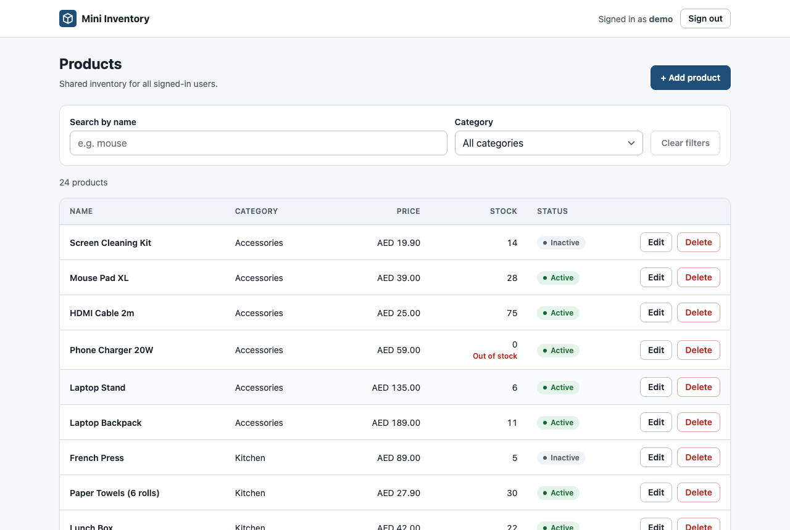
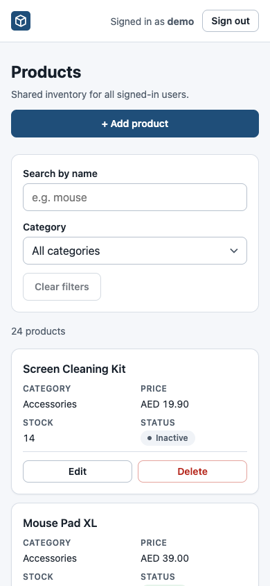
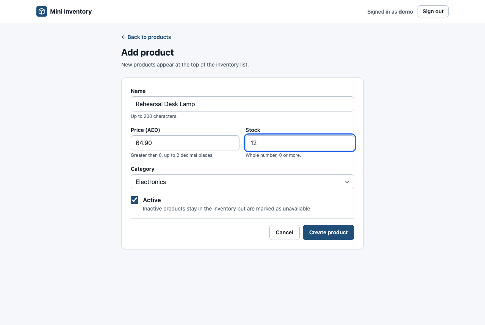
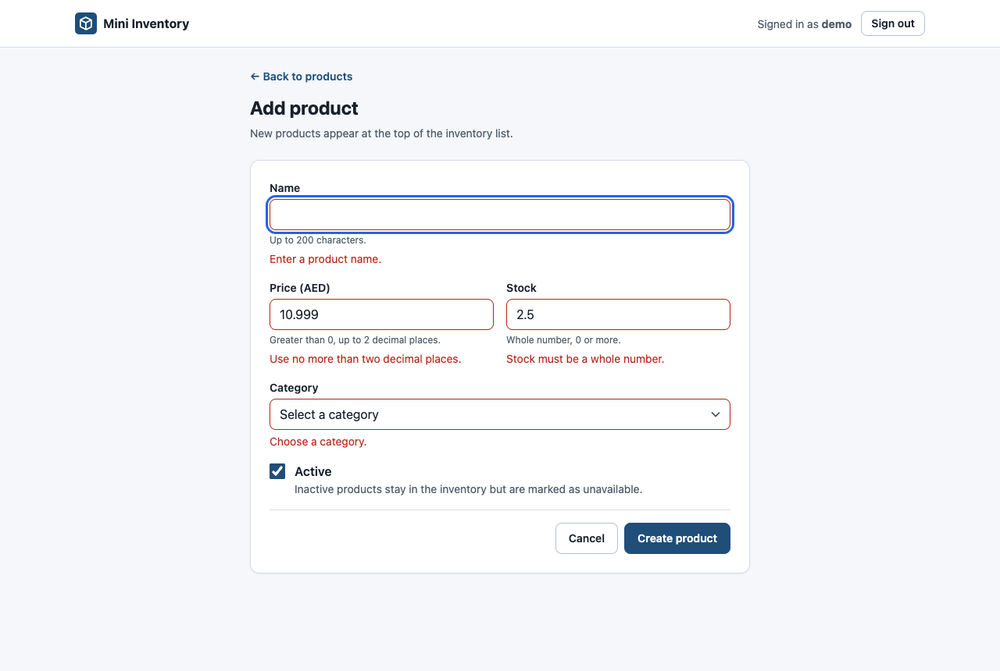
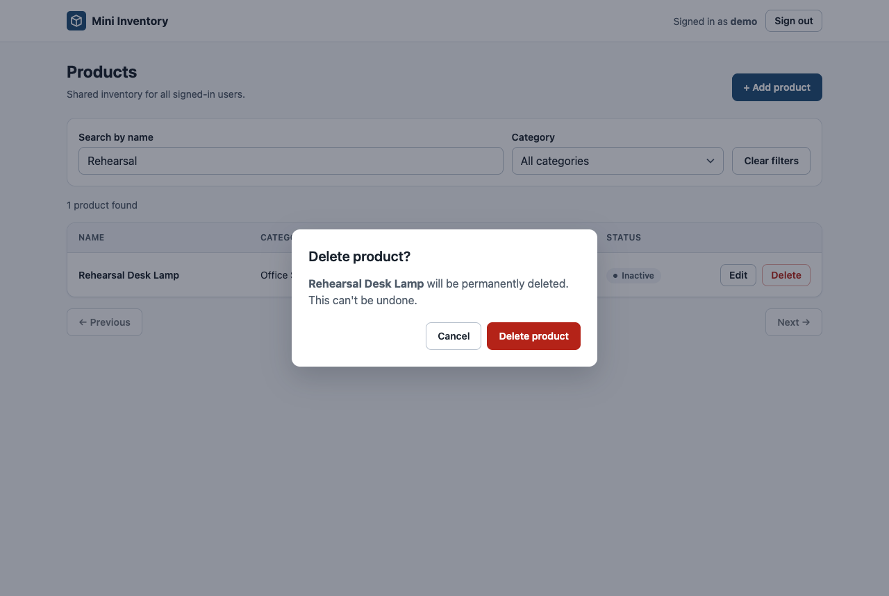

# Mini Inventory System

A small full-stack inventory app built for a two-day assessment. Signed-in users share one product inventory. They can browse it page by page, search and filter it, and add, edit and delete products.

- **Backend:** Django 5.2, Django REST Framework, token authentication, SQLite.
- **Frontend:** React 19, TypeScript, Vite, TanStack Query, React Router, React Hook Form and Zod.
- **Docker:** An optional Compose stack serves the production build through nginx.



## Features

- Sign in with a username and password, and sign out with the token revoked on the server.
- A product table with server-side pagination of 10 per page, a category filter and a debounced name search.
- Page, category and search live in the URL, so reload, back and forward all restore the view.
- One shared form for add and edit, with client validation that mirrors the backend rules. Server field errors appear next to the matching inputs.
- Delete asks for confirmation in an accessible dialog. Deleting the last row on a page moves you to the previous page.
- Loading skeletons, error states with retry, an empty inventory with an add action, and no-results with a clear-filters action.
- A responsive layout: a table on desktop and cards on narrow screens, with actions always visible.
- 24 seeded products in 4 categories, including out-of-stock and inactive items.

| Mobile | Add product | Validation | Delete confirmation |
|---|---|---|---|
|  |  |  |  |

These screenshots are real captures of the running app.

## Demo login

| Username | Password |
|---|---|
| `demo` | `demo-pass-2026` |

The seed command creates this disposable local account. It has no staff or admin rights. Set `DEMO_PASSWORD` before the first seed to use a different password.

## Prerequisites

- Python 3.12. Development and Docker both used 3.12.
- Node.js 20 or newer with npm 10 or newer. Node 22 built the Docker image and Node 25 ran local development. The lockfile was checked with `npm ci` on npm 10 and npm 11.
- Docker with Compose v2.24 or newer. This is only needed for the Docker setup.

## Run locally

Use two terminals, starting from the repository root.

### 1. Backend (http://127.0.0.1:8000)

```bash
cd backend
python3.12 -m venv .venv
source .venv/bin/activate            # Windows: .venv\Scripts\activate
pip install -r requirements-dev.txt
cp .env.example .env                 # DJANGO_DEBUG=true; see the file for all settings
python manage.py migrate
python manage.py seed_data           # safe to re-run
python manage.py runserver 127.0.0.1:8000
```

`seed_data` can be run any number of times. It never duplicates rows, overwrites edited products or resets an existing password. To reset the demo password, run `python manage.py seed_data --reset-demo-password`. For the Django admin at `/admin/`, create an account with `python manage.py createsuperuser`.

### 2. Frontend (http://localhost:5173)

```bash
cd frontend
npm ci
cp .env.example .env.local           # optional: the defaults already target the local backend
npm run dev
```

Open http://localhost:5173 and sign in with the demo account.

### Configuration

**`backend/.env`**, copied from `backend/.env.example`:

| Variable | Default | Purpose |
|---|---|---|
| `DJANGO_DEBUG` | `false` | Set to `true` for local development. |
| `DJANGO_SECRET_KEY` | none | Required when debug is off. Debug mode falls back to an insecure development key. |
| `DJANGO_ALLOWED_HOSTS` | `localhost,127.0.0.1` | Hosts Django will serve. |
| `CORS_ALLOWED_ORIGINS` | `http://localhost:5173,http://127.0.0.1:5173` | Explicit list of frontend origins. |
| `CSRF_TRUSTED_ORIGINS` | empty | Needed only for admin logins behind a proxy. |
| `SQLITE_PATH` | `db.sqlite3` | Database file, relative to `backend/` or absolute. |
| `LOGIN_THROTTLE_RATE` | `10/min` | Login attempts allowed per client IP. |
| `NUM_PROXIES` | unset | Number of trusted proxies, used for the client IP. Docker sets it to 1. |
| `DEMO_PASSWORD` | `demo-pass-2026` | Demo user's password when `seed_data` first creates it. |

**`frontend/.env.local`**, copied from `frontend/.env.example`. These values are baked in at build time.

| Variable | Default | Purpose |
|---|---|---|
| `VITE_API_BASE_URL` | `http://127.0.0.1:8000` | API origin. An empty value means the same origin, which Docker uses. |
| `VITE_CURRENCY` | `AED` | ISO 4217 code used to display prices. |
| `VITE_LOCALE` | `en-US` | Number formatting locale. It is fixed, so the display never depends on the viewer's browser. |

## Tests and checks

```bash
# backend (from backend/, with the venv active)
pytest                                        # API, validation, constraints, seeding
python manage.py makemigrations --check --dry-run
python manage.py migrate --check

# frontend (from frontend/)
npm test                                      # Vitest + Testing Library
npm run typecheck
npm run lint
npm run build                                 # production bundle in frontend/dist
```

The frontend tests run against an in-memory mock of the documented API contract in `frontend/src/test/mockApi.ts`. They cover login, protected routes, list states, debounced search, filter and page reset, form validation, server field errors, delete cancel, confirm and failure, and pagination recovery.

## Docker

```bash
cp .env.example .env                              # optional: port, currency, locale, seeding
cp backend/docker.env.example backend/docker.env  # optional: secret key, demo password
docker compose up --build
```

Open http://localhost:8080 and sign in with the demo account.

- **frontend:** A multi-stage build compiles the React app, and nginx serves it. nginx forwards `/api/`, `/admin/` and `/static/` to the backend, and any other path falls back to `index.html`, so direct links like `/products/12/edit` work.
- **backend:** Gunicorn serves Django, and whitenoise serves the admin's static files. The backend isn't published to the host.
- **Startup:** The backend runs `migrate` on every start. It then runs `seed_data` when `SEED_ON_START=true`, the default, which is safe because seeding is idempotent. The frontend waits until the backend passes its health check.
- **Storage:** The SQLite database lives in the named volume `inventory-data`. So does a secret key generated on first start, unless you set `DJANGO_SECRET_KEY`. Data survives `docker compose down`, rebuilds and container recreation. Run `docker compose down -v` to wipe it.

Useful commands:

```bash
docker compose exec backend python manage.py seed_data          # seed manually
docker compose exec backend python manage.py migrate            # run migrations manually
docker compose exec backend python manage.py createsuperuser    # admin at http://localhost:8080/admin/
docker compose logs -f backend
```

## API overview

The full contract, with request and response examples, error shapes and status codes, is in [docs/API_CONTRACT.md](docs/API_CONTRACT.md).

| Method | Path | Notes |
|---|---|---|
| POST | `/api/auth/login/` | Public. Takes `{username, password}` and returns `{token, user}`. Throttled. |
| GET | `/api/auth/me/` | Returns the current user. |
| POST | `/api/auth/logout/` | Deletes the token and returns 204. |
| GET | `/api/categories/` | Unpaginated `[{id, name}]` sorted by name. Read-only. |
| GET, POST | `/api/products/` | List takes `?page=`, `?category=` and `?search=`. Create returns 201. |
| GET, PUT, PATCH, DELETE | `/api/products/{id}/` | Retrieve, full update, partial update and permanent delete. |

Every endpoint except login needs `Authorization: Token <token>`.

## Project structure

```
backend/
  config/            settings (environment-driven), urls
  accounts/          login / me / logout views
  inventory/         models, serializers, viewset, filters, admin, seed_data command
  tests/             pytest suite
frontend/src/
  lib/               API client (token header, 401 handling), token store, query client, formatting
  components/        Button, Field, Alert/Toast/Skeleton, ConfirmDialog, AppLayout
  features/auth/     AuthProvider + useAuth, LoginPage, route guards
  features/products/ list page, table, ProductForm, add/edit pages, delete dialog, queries, schema
  test/              contract-based fetch mock, render helper
docs/                API contract, screenshots
```

## Architecture decisions

- **SQLite.** It needs no database server, so the project runs straight after `git clone`. The schema uses only portable features. A database CHECK constraint enforces `price > 0` and `stock >= 0`, stock is capped at the 32-bit limit, and money uses `DecimalField`. Moving to PostgreSQL is a settings change.
- **DRF token authentication.** It is simple and stateless for a separate frontend. The client sends `Authorization: Token …`, so no cookies and no CSRF handling are needed. Login is throttled, and logout deletes the token on the server.
- **Shared inventory with equal permissions.** The assessment describes one inventory. Every authenticated user can read and change every product, so there are no per-user ownership checks.
- **Decimal prices as strings.** The API returns prices like `"49.90"` and the frontend keeps them as strings in form state and payloads. This avoids floating-point rounding. Validation mirrors `DecimalField(max_digits=10, decimal_places=2)`.
- **Read-only category API.** Categories change rarely, so they are managed in the Django admin. The API only lists them for the filter and the form. Deleting a category that has products is blocked by `PROTECT`.
- **Server-side filtering and pagination.** The client never downloads the whole inventory. The query cache key includes every request parameter, `["products", {page, category, search}]`, so a slow response for an old search can never replace newer results.
- **TanStack Query for server state.** It handles caching, request cancellation and retry, and it keeps the previous page visible while the next one loads. Row actions are disabled during those transitions. Auth state lives in a small React context, dialogs and notifications use local state, and there is no global store.
- **Server-confirmed mutations.** The UI updates after the server succeeds. It doesn't update optimistically. After a save, the affected product lists are refetched, and after a delete, the product's cached detail is removed.
- **Permanent deletion.** `DELETE` removes the row. There is no soft delete. Marking a product inactive is the non-destructive option, and inactive products stay visible and editable.
- **Last-write-wins editing.** Edits use `PUT` with no version check. If two people edit the same product, the later save overwrites the earlier one without warning.

## Known limitations

- **Tokens don't expire.** A DRF token stays valid until logout deletes it, or an admin deletes it.
- **One token per user.** Every session for the same user shares one token. Signing out in one tab or device signs that user out everywhere.
- **The token is kept in `sessionStorage`.** It survives a reload but not closing the tab, and a new tab needs a new sign-in. Any script running on the page can read it, so it is only as safe as the app's resistance to cross-site scripting. An HttpOnly cookie session would be safer.
- **Session-end handling.** If the server rejects the token with a 401, the app signs out, clears cached data, and returns to login with a message.
- **Per-process login throttling.** The throttle counts attempts in an in-memory cache. Counts reset on restart and aren't shared between processes. Docker runs one Gunicorn process for this reason.
- **SQLite limits concurrent writes.** That is fine for a demo but not for heavy multi-user use.
- **Display-only currency.** The currency setting only changes how prices look. Prices are stored without a currency.
- **No visual or browser-matrix testing.** The checks used headless Chrome on desktop and mobile viewports.

## Improvements with more time

- Expiring, rotatable tokens or HttpOnly cookie sessions, plus one token per device.
- Optimistic concurrency, such as a `version` or `updated_at` precondition on `PUT`, to avoid silent overwrites.
- PostgreSQL and a shared cache such as Redis for throttling. Category management in the UI, soft delete or an audit log, and sortable columns.
- A committed browser end-to-end suite such as Playwright, run in CI with the unit tests, lint and type checks.

## Repository hygiene

- Dependency manifests, lockfiles and migrations are committed.
- `.env` files, SQLite databases, `node_modules`, build output and macOS `._*` files are ignored.
- Example environment files are `backend/.env.example`, `backend/docker.env.example`, `frontend/.env.example` and `.env.example`.
- No real secrets are committed. The only credentials are the disposable demo account above.
